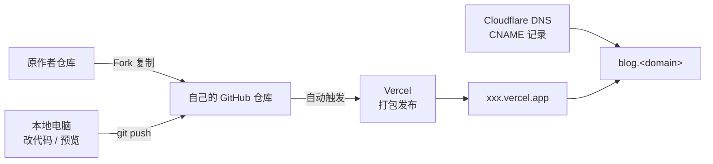

# 用 Vercel 部署网站并绑定自有子域名

整条链路：别人的仓库 → Fork 成自己的 → Vercel 自动打包发布 → Cloudflare DNS 把子域名指过去。
上线后网站跑在 Vercel 的服务器上，本机关机也能访问；以后改代码推到 GitHub，Vercel 自动重新部署。

## 什么时候用

- 想参考某个开源博客/网站，做一个自己的并公开访问。
- 网站要 24 小时在线，但不想让自己电脑一直开着（区别于 Cloudflare Tunnel 方案，见 [../../../cf/skills/cloudflare-tunnel/SKILL.md](../../../cf/skills/cloudflare-tunnel/SKILL.md)）。
- 已有自己的域名（在 Cloudflare 托管），想挂一个子域名。

## 先选平台

看项目本身按哪个平台配的，就用哪个，能少改代码：

- 有 `vercel.json`，或 `astro.config.*` / `next.config.*` 里用了 `@astrojs/vercel` 等 Vercel 适配器 → **用 Vercel**（本 skill）。
- 按 Cloudflare 配的（`wrangler.toml`、`@astrojs/cloudflare`）→ 用 Cloudflare Pages。
- 纯静态站两家都行；域名在 Cloudflare 的话 Pages 绑域名更顺手。

三种方案的区别（VPS / Vercel / Pages / 本机+隧道）见 [references/concepts.md](references/concepts.md)。

## 步骤

### 1. 本地下载并预览（可选，但建议先跑通）

1. 下载到本地，例如 `%USERPROFILE%\Desktop\<工作目录>\<项目名>`。
2. 用项目指定的包管理器装依赖：先看 `package.json` 的 `packageManager` 字段，没有就看锁文件（`bun.lock` → Bun，`pnpm-lock.yaml` → pnpm，`package-lock.json` → npm）。用错了可能缺包。
3. 启动开发服务器，浏览器打开 `http://localhost:<端口>` 预览。

Windows 下的具体命令、国内镜像、代理问题见 [references/local-run-windows.md](references/local-run-windows.md)。
本地预览只有自己能看，关掉电脑就没了，它和线上网站互不影响。

### 2. Fork 到自己的 GitHub

1. 打开原仓库页面，右上角 **Fork** → **Create fork**。
2. Owner 选自己的账号；若提示 `already exists`，改个仓库名（或先处理掉同名旧仓库）。
   - 若提示 **No available destinations to fork this repository**：说明你已经 fork 过这个仓库（GitHub 每个账号只能 fork 同一仓库一次）。直接用已有的 Fork，跳到第 3 步新建 Vercel 项目即可。
3. 保持勾选 **Copy the main branch only**。

Fork = 把别人的仓库复制一份到自己账号下，之后怎么改都不影响原作者。Vercel 只能部署自己账号能授权的仓库，所以必须先 Fork。

### 3. 在 Vercel 部署

1. 打开 https://vercel.com/signup ，选 **Continue with GitHub** 登录。
2. 选套餐时保持 **Hobby（我正在开发个人项目）**，免费；**不要选 Pro**。团队名随便填，可后改。
3. 在 **Import Git Repository** 点 **GitHub**，授权 Vercel 读取仓库（可只勾这一个）。
4. 选中刚 Fork 的仓库 → **Import**。**Project Name** 填一个好认的名字（同名项目已存在时 Vercel 会自动加随机后缀，如 `blog-45ir`，建议手动改成 `blog-demo` 这类）。框架（Application Preset）一般会自动识别。
5. 点 **Create Project**（新版界面先建项目，再单独点 **Deploy**）。推荐集成（如 Neon 数据库）不需要就别加。
6. **Astro + `@astrojs/vercel` 旧适配器的项目**：建议在点 Deploy 之前，先去项目 **Settings → Build and Deployment → Node.js Version** 选 `22.x` → Save，可避开 Node 18 运行时报错（详见 troubleshooting）。忘了也没关系，部署失败后改版本再 Redeploy。
7. 点 **Deploy**。首次部署会弹 **Verify Your Identity**，点 **Send Code**，去注册邮箱（含垃圾箱）找主题为 `Your Vercel security code: xxxxxx` 的邮件，5 分钟内填入 → **Verify Code**。
8. 状态变成 **Ready** 即成功，会得到一个 `xxx.vercel.app` 网址。

部署失败先看 **Build Logs** 末尾的报错，常见问题见 [references/troubleshooting.md](references/troubleshooting.md)。

### 4. 绑定 Cloudflare 上的子域名

1. Vercel 项目左侧 **Domains** → **Add Existing**（不要点 Buy）→ 输入 `blog.<domain>`，选 **Connect to an environment: Production** → **Add Domain**。
2. 此时显示红色 **Invalid Configuration**，点该域名那一行（**View DNS configuration**）展开，记下它给的记录，例如：
   - Type `CNAME`，Name `blog`，Value `xxxxxxxx.vercel-dns-0xx.com`（每个项目不同，以页面为准，用复制按钮）。
3. 打开 Cloudflare 控制台 → 选域名 → **DNS → Records → Add record**（新版 DNS 页首次进入会弹介绍浮层，点 **Got it** 关掉）：
   - Type：`CNAME`
   - Name：`blog`
   - Target：粘贴 Vercel 给的值（末尾的点会自动加，无影响）
   - Proxy status：**点成灰色云朵 DNS only**（橙色代理会和 Vercel 的证书冲突）
   - 保存。
4. 回 Vercel 点 **Refresh**，中间会短暂显示 **Generating SSL Certificate**，一般 1 分钟内变成蓝勾 **Valid Configuration**，HTTPS 证书由 Vercel 自动签发。
5. 用 [scripts/check-site.ps1](scripts/check-site.ps1) 或浏览器确认能打开。

已有的其他子域名（如 Tunnel 的 `api.<domain>`）不受影响；子域名免费、数量不限。

### 5. 收尾

1. 关掉本地开发服务器，网站不依赖本机。
2. 把本地仓库的上传地址改成自己的 Fork，以后才能推送：
   `git remote set-url origin https://github.com/<你的账号>/<仓库名>.git`
3. 尽快把原作者的个人信息（站名、作者、头像、文章、收款码/二维码、统计与评论配置）替换掉，避免被误认为是对方的网站。

## 撤掉网站

不要了的站点或测试站，用同目录的 [vercel-remove-site](../vercel-remove-site/SKILL.md) 技能按「Cloudflare 记录 → Vercel 项目 → 按需删仓库和本地副本 → 验证」的顺序撤掉。多个项目共用一个仓库时只删 Vercel 项目。

## 用浏览器自动化执行（ego / Playwright 类工具）

整套流程已用 ego 浏览器完整跑过一遍。自动化时注意：

1. 先确认 GitHub、Vercel、Cloudflare 三个站在该浏览器里都已登录；未登录就交给用户登录，不要代填密码。Vercel 选 **Continue with GitHub**。
2. 按钮多为无 id 的 React 组件，按可见文字定位（`Create fork`、`Create Project`、`Deploy`、`Add Existing`、`Add Domain`、`Save`），点击后重新观察页面再走下一步。
3. Vercel 验证码可以直接从邮箱读取（有 Gmail 连接器时搜 `from:vercel newer_than:1h`）。
4. Cloudflare 添加记录弹窗里，Type 是可输入的下拉框（输入 `CNAME` 再选），Target 是 `textarea[name=target]`，代理开关是 `button[aria-label="Proxy status"]`，`aria-checked=false` 即 DNS only。保存前核对弹窗顶部那句「xxx is an alias of yyy」。

## 日常更新

改代码 → `git push` 到 `main`（或直接在 GitHub 网页上改）→ Vercel 自动重新部署，一两分钟后线上更新。
不需要手动点 Redeploy；只有改了 Vercel 项目设置（如 Node 版本、环境变量）才需要手动 Redeploy 一次。

## 安全与费用

- 全程只用 Vercel Hobby 和 Cloudflare Free，不绑卡、不开任何付费附加项。Hobby 超额只会被限流/暂停，不会扣费。
- Hobby 仅限非商业个人项目。
- 不要把原作者仓库里的密钥、`.env`、收款码当成自己的继续用。

## 官方文档

- https://vercel.com/docs/getting-started-with-vercel
- https://vercel.com/docs/domains/working-with-domains/add-a-domain
- https://vercel.com/docs/functions/runtimes/node-js/node-js-versions
- https://vercel.com/docs/plans/hobby
- https://developers.cloudflare.com/dns/manage-dns-records/how-to/create-dns-records/
